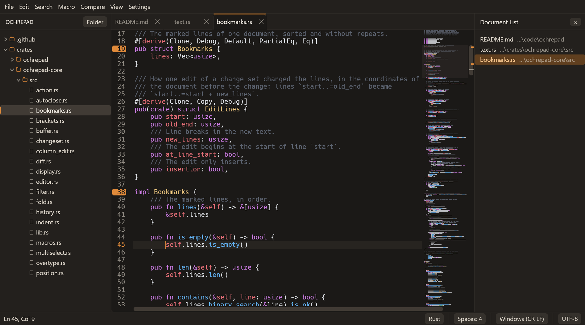

# ochrepad

[](https://github.com/xor295/ochrepad/actions/workflows/ci.yml)

A fast, native text editor in the spirit of Notepad++, written in Rust with
[egui](https://github.com/emilk/egui).



## Features

- **Syntax highlighting** for over 180 languages (syntect with the
  [two-face](https://github.com/CosmicHorrorDev/two-face) syntax set), detected
  by extension, file name or shebang. Highlighting is incremental, so typing
  stays smooth in very large files; files over a size limit (10 MB by default)
  open without it. File > Export > HTML… saves a document as a web page in
  its highlighting colours ([more](docs/file-handling.md#saving)).
- **Column selection and multiple cursors**: Alt+drag or Alt+Shift+arrows for
  a rectangle, Ctrl+click to add a caret, Ctrl+Alt+Up/Down to add one above or
  below. Rectangular copy and paste work as blocks
  ([more](docs/column-selection.md)).
- **Find and replace** with regular expressions, match case, whole word, wrap
  around and in-selection, `$1`/`${name}` in replacements, Count, Select All
  (one caret per match) and Replace All as a single undo step. Find All
  lists the matches in one or every open document in a results panel, and
  Replace All can also work on every open document. Find in Files
  (Ctrl+Shift+F) searches a folder on disk, honouring `.gitignore`, and
  Replace in Files rewrites the matches there (after asking). Words
  can be styled in five colours to keep them in sight. See
  [docs/find-and-replace.md](docs/find-and-replace.md) for the regex dialect.
- **Bookmarks**: Ctrl+F2 marks a line, F2 and Shift+F2 jump between marks,
  the find panel bookmarks every line with a match, and the bookmarked
  lines can be copied, cut or removed at once
  ([more](docs/editing.md#bookmarks)).
- **Macros**: record, play back once, N times or to the end of the file, save
  them with a name and a shortcut ([more](docs/macros.md)).
- **Code folding** by indentation (and by heading in Markdown), with
  Notepad++'s fold shortcuts; folds are kept with the session
  ([more](docs/view.md)).
- **Document map**: a zoomed-out view of the file beside the text, to see
  its shape and jump around ([more](docs/view.md#document-map)).
- **Change history**: the gutter marks the lines you changed, added or
  deleted since the file was saved ([more](docs/view.md#change-history)).
- **Function List**: a panel of the document's functions, types and
  headings, filtered as you type; click one to go there
  ([more](docs/view.md#function-list)).
- **Document List**: a panel of the open documents in tab order, to see
  and switch between many files ([more](docs/view.md#document-list)).
- **Word wrap** at the pane's edge, with continuation rows indented like
  the line ([more](docs/view.md#word-wrap)).
- **Folders**: open a folder to browse its files in a sidebar, with
  `.gitignore`d files hidden, live updates, and new file, new folder and
  rename ([more](docs/workspace.md)).
- **Tabs and split screen**: drag tabs into side-by-side or stacked panes, or
  open a second view of the same file; edits show in both.
- **Compare**: a side-by-side diff of two files (or a file against its saved
  version) with aligned lines, changed words highlighted, and F8/Shift+F8 to
  jump between changes. Both sides are editable, with syntax highlighting,
  and the diff updates as you type.
- **Markdown preview** beside the editor, updating as you type, with images
  (PNG, JPEG, WebP, SVG) loaded from the document's folder. Web and mail
  links open in the browser, links to files open in ochrepad, and other
  kinds of link are not followed.
- **Logs**: filter a file down to the lines that match (or don't), colour
  lines by log level, and follow a file as another program writes it
  (tail -f) ([more](docs/logs.md)).
- **Backups and session restore**: unsaved work is backed up every few seconds
  and comes back, with your tabs and layout, the next time you start. Optional
  automatic saving of named files ([more](docs/backups-and-session.md)).
- **Notepad++'s editing habits**: overtype (Insert), Begin/End Select,
  Split Lines (Ctrl+I), comment and uncomment (Ctrl+Q, Ctrl+K,
  Ctrl+Shift+K), closing brackets and smart indentation as you type
  (optional), a right-click menu that opens the file or web link at the
  caret, and Ctrl+Shift+PageUp/PageDown to move tabs
  ([more](docs/editing.md)).
- **Text tools**: UPPER/lower/Title/Sentence/iNVERT/random case, sort lines
  (ascending, descending, case-insensitive, numeric, by length, by a column
  selection) or put them in a random order, duplicate, move, join lines,
  trim trailing whitespace, and remove empty or duplicate
  lines. JSON format, minify and validate (key order and numbers kept),
  Base64, URL and hex encoding, and MD5, SHA-1 and SHA-256 hashes
  ([more](docs/text-tools.md)). Notepad++'s line and blank operations
  (delete, transpose, reverse, trim, EOL to space, tabs and spaces) and its
  Column Editor for text or number sequences down a column
  ([more](docs/editing.md)).
- **Faithful file handling**: UTF-8, UTF-16 and legacy encodings are detected,
  and files are saved back with the same encoding, BOM and line endings
  (CRLF, LF or CR). Saves are atomic, so a crash never leaves a half-written
  file. Binary files are refused rather than mangled
  ([more](docs/file-handling.md)).
- **Huge files**: files over 256 MB open read-only in a viewer that shows the
  first screen at once and never reads the whole file into memory: scroll,
  select, copy, Go to Line and search a 4 GB log while its line index builds
  in the background ([more](docs/logs.md)).
- **Watches open files**: if another program changes or deletes one, ochrepad
  offers to reload it (or warns you if you have unsaved changes).
- Preferences for font, size, tabs or spaces, tab width, theme, and backups;
  an editable keymap; recent files; drag and drop to open.

Not included (by design, for now): right-to-left
text, proportional fonts, plugins and language servers.

## Download

ochrepad runs on Windows and Linux (x86-64). Download the latest version from
the [releases page](https://github.com/xor295/ochrepad/releases):

- **Windows**: `ochrepad-<version>-windows-x86_64.zip`. Unzip it anywhere and
  run `ochrepad.exe`; there is nothing to install. The program isn't signed
  yet, so the first time, Windows SmartScreen may say it "protected your
  PC": choose **More info**, then **Run anyway**.
- **Linux**: `ochrepad-<version>-linux-x86_64.tar.gz`. Extract it and run
  `ochrepad`. It needs an X11 or Wayland desktop with Vulkan or OpenGL
  drivers, and runs on distributions as old as Ubuntu 22.04.

Each release lists SHA-256 checksums, and every download carries a signed
record that it was built by this repository's release workflow; the release
notes say how to check it.

## Building

You need a recent stable [Rust toolchain](https://rustup.rs) (1.88 or newer).

```sh
git clone https://github.com/xor295/ochrepad.git
cd ochrepad
cargo build --release
```

The program is `target/release/ochrepad` (`ochrepad.exe` on Windows). Pass file
names to open them:

```sh
ochrepad notes.md src/main.rs
```

On Windows the build embeds the icon into the executable; that needs the
Windows SDK's resource compiler (installed with the Visual Studio C++ build
tools that Rust uses). Without it the build still succeeds, with a warning.

On Linux, install eframe's recommended development packages first (Debian
and Ubuntu names):

```sh
sudo apt-get install libxcb-render0-dev libxcb-shape0-dev libxcb-xfixes0-dev libxkbcommon-dev
```

To run it you need an X11 or Wayland desktop with Vulkan or OpenGL drivers.
File dialogs go through the XDG desktop portal.

ochrepad is developed on Windows 11; CI builds and tests every change on
Windows and Linux. macOS is not supported.

## Keyboard shortcuts

| | |
|---|---|
| New, Open, Save, Save As | Ctrl+N, Ctrl+O, Ctrl+S, Ctrl+Shift+S |
| Close tab, next/previous tab | Ctrl+W (or middle click), Ctrl+Tab or Ctrl+PageDown, Ctrl+Shift+Tab or Ctrl+PageUp |
| Move the tab back or forward along the bar | Ctrl+Shift+PageUp, Ctrl+Shift+PageDown |
| Reopen the file closed last | Ctrl+Shift+T |
| Undo, Redo | Ctrl+Z, Ctrl+Y (or Ctrl+Shift+Z) |
| Find, Replace | Ctrl+F, Ctrl+H |
| Find next/previous | F3, Shift+F3 (Enter, Shift+Enter in the panel) |
| Select and find next/previous | Ctrl+F3, Ctrl+Shift+F3 |
| Find in Files | Ctrl+Shift+F |
| Column selection | Alt+drag, Alt+Shift+arrows |
| Add a caret | Ctrl+click, Ctrl+Alt+Up/Down |
| Back to one caret | Esc |
| Select a line | click its line number (drag for several) |
| Go to line | Ctrl+G |
| Bookmark a line, next, previous | Ctrl+F2, F2, Shift+F2 |
| Indent, unindent | Tab (with lines selected), Shift+Tab |
| Toggle comment, block comment | Ctrl+/ or Ctrl+Q, Ctrl+Shift+/ or Ctrl+Shift+Q |
| Comment, uncomment lines | Ctrl+K, Ctrl+Shift+K |
| Matching bracket: go, select | Ctrl+B, Ctrl+Alt+B |
| Duplicate, move, join, split lines | Ctrl+D, Ctrl+Shift+Up/Down, Ctrl+J, Ctrl+I |
| Delete line, swap with the line above | Ctrl+Shift+L, Ctrl+T |
| New line above, below | Ctrl+Alt+Enter, Ctrl+Alt+Shift+Enter |
| Column Editor (text or numbers down a column) | Alt+C |
| Type over the text (overtype), and back | Insert |
| Fold, unfold the block at the caret | Ctrl+Alt+F, Ctrl+Alt+Shift+F |
| Fold all, unfold all, fold a level | Alt+0, Alt+Shift+0, Alt+1 … Alt+8 |
| UPPERCASE, lowercase | Ctrl+Shift+U, Ctrl+U |
| Title Case, Sentence case (blend: with Shift) | Alt+U, Ctrl+Alt+U |
| iNVERT cASE | Ctrl+Alt+I |
| Record/stop macro, play macro | Ctrl+Shift+R, Ctrl+Shift+P |
| Markdown preview | Ctrl+Shift+M |
| Full screen | F11 |
| Zoom in, out, back to 100% | Ctrl+plus, Ctrl+minus, Ctrl+0 (or Ctrl+wheel) |
| Show all characters | Ctrl+Shift+8 |
| Filter lines | Alt+Shift+L |
| Show or hide the sidebar | Ctrl+Shift+E |
| Next/previous difference (or change since saving) | F8, Shift+F8 |

Double-click the empty part of a tab bar to open a new tab there. Sorting and
the other line tools are in **Edit > Line Operations**.

## Configuration

**Settings > Preferences** covers the editor font and size, tab width, tabs or
spaces, light/dark theme, syntax theme, backups and automatic saving, the
size above which highlighting is turned off, and a vertical edge line.

Everything is stored as JSON in your configuration folder:

| | Windows | Linux |
|---|---|---|
| Settings, keymap, macros, session | `%APPDATA%\ochrepad\config` | `~/.config/ochrepad` |
| Backups of unsaved work | `%APPDATA%\ochrepad\data\backup` | `~/.local/share/ochrepad/backup` |

- `settings.json`: the preferences and the recent files list.
- `keymap.json`: your key bindings. **Settings > Edit Keymap** opens it,
  starting from every default binding, and saving it applies it. Each entry
  replaces the default binding for its keys; `"command": null` removes one.
  [Key bindings](docs/keymap.md) lists every command:

  ```json
  [
    { "keys": "Ctrl+D", "command": { "Action": "SelectLine" } },
    { "keys": "Ctrl+J", "command": null }
  ]
  ```
- `macros.json`: saved macros and their shortcuts.
- `session.json`: open tabs, layout, carets and scroll positions.

More about each feature is in [docs/](docs/README.md).

## Development

The editor is a Cargo workspace:

| Crate | What it does |
|---|---|
| `crates/ochrepad-core` | The text model and every editing operation: positions, selections, actions, undo, search, transforms, macros, diff. No UI and no file access, so it is tested headlessly. |
| `crates/ochrepad-fileio` | Loading and saving: encoding and line-ending detection, atomic writes, the background writer, backups and config files. |
| `crates/ochrepad-syntax` | Incremental syntax highlighting on syntect. |
| `crates/ochrepad` | The egui application: the editor widget, tabs and splits, panels, preview, compare view. |

```sh
cargo test --workspace                        # all tests
cargo clippy --all-targets -- -D warnings     # lints
UPDATE_SNAPSHOTS=1 cargo test -p ochrepad     # regenerate UI snapshot images
```

The app's tests drive the real UI with
[egui_kittest](https://github.com/emilk/egui/tree/main/crates/egui_kittest):
they type, click and drag, then check the text and selections; snapshot tests
compare rendered images. Benchmarks for scrolling, find and diff on large files
are under `crates/ochrepad/examples` (generate the test files first with
`cargo run --release -p ochrepad --example gen_perf_fixtures`).

## License

[MIT](LICENSE)
